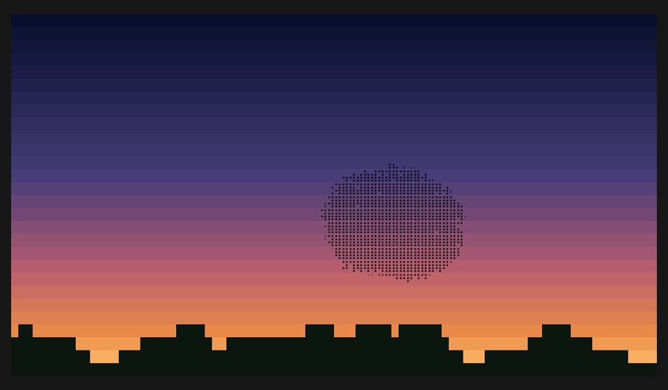

# murmuration

Starlings at dusk, in your terminal.

murmuration is a live, three-dimensional flock of a few thousand starlings,
watched from the ground and drawn in braille silhouettes against an evening sky.
Birds gather, bank, stretch and sometimes split; an optional falcon brings alarm
and escape responses. The flock's shapes come from individual birds following
local rules, not from a prerecorded animation or a choreographed outline.

It's an ambient piece, not a game: no score, no objectives, nothing you have to do.
Leave it running between tasks, or step in as the falcon.



Recorded from the current live application: **4,000 birds, seed 42, display-only
dusk and an autonomous falcon**. The GIF loops for the preview; the application
simulates the birds continuously. See [recording the demo](#recording-the-demo).

> **Status:** a working, evolving simulation. It is inspired by flocking research,
> but is not an exact reproduction of a published model. See
> [limitations](#limitations) and [DEVELOPMENT.md](DEVELOPMENT.md) for the measured
> behaviour and documented adaptations.

## Getting started

Requires **Rust 1.88 or newer** to build. A truecolour terminal and a monospace
font with braille glyphs give the best result. The application runs locally,
without network access, accounts or required configuration files.

Install from this repository:

```sh
cargo install --git https://github.com/ImanolGo/murmuration
```

Or, from a local checkout:

```sh
cargo install --path .
```

For an immediate view of the flock at dusk:

```sh
murmuration --no-arc --birds 4000 --colors truecolor
```

Add `--falcon` for an autonomous hunter. To run without installing, use
`cargo run --release --` followed by the same options.

## Usage

```sh
murmuration                              # a complete evening, starting with arrivals
murmuration --no-arc                      # start with a flock and stay at dusk
murmuration --no-arc --falcon              # display with an autonomous hunter
murmuration --arc-minutes 5               # a shorter evening cycle
murmuration --birds 5000 --seed 7          # a repeatable seeded simulation
murmuration --screensaver --no-arc        # exit on a key or captured mouse event
murmuration --no-mouse                    # leave the mouse to your terminal
murmuration --colors none                 # plain braille, using terminal colours
```

| Option | Behaviour |
| --- | --- |
| `--birds N` | Flock size; by default, chosen from terminal area between 4,000 and 8,000 birds. |
| `--seed N` | Choose the simulation's random seed; otherwise each run gets a fresh one. |
| `--falcon` | Add an autonomous falcon that patrols, climbs, dives and retreats. |
| `--no-arc` | Hold the display phase at dusk, without arrivals, roosting or night. |
| `--arc-minutes N` | Length of the repeating evening cycle; default 15 minutes. |
| `--screensaver` | Exit on keyboard or captured mouse input. With `--no-mouse`, mouse movement does not exit. |
| `--no-mouse` | Disable mouse capture and mouse-driven hunting. |
| `--colors MODE` | `auto` (default), `truecolor`, `ansi256`, or `none`. |

Use `murmuration --help` for all options. Keep the bird count and settings fixed
when comparing seeded runs; camera choices, terminal size and interaction affect
what you see.

### Controls

| Input | Action |
| --- | --- |
| `q` / `Esc` | Quit and restore the terminal. |
| `Space` | Pause/resume the birds, sky clock, wind and visual fades. |
| Move the mouse | Spawn a falcon if needed and steer it towards the cursor, with flight lag rather than teleportation. |
| `f` | Spawn an autonomous falcon if none exists. |
| `+` / `=` | Add 250 birds and increase the evening's target flock size. |
| `-` | Remove up to 250 birds and reduce the target size. |
| `c` | Change the observer's bearing around the roost. |
| `s` | Save the current frame as ANSI text in the working directory. |

Moving the mouse switches the existing falcon to mouse control; `f` does not
reset an already-spawned falcon. Use `--no-mouse` if you want only autonomous
hunting or don't want the application to capture terminal mouse events.

Saved frames are named `murmuration-frame-seed<seed>-<time>s.ansi`. Use
`--colors truecolor` for colour-preserving snapshots; the current exporter writes
RGB styles, while other colour modes are saved without those colours.

### The evening

Without `--no-arc`, an evening lasts 15 minutes by default, then starts another:

1. **Arrival:** compact groups approach the roost through a shared corridor.
2. **Display:** the birds fly over the roost while the sky shifts towards dusk.
3. **Roosting:** the preferred flight height lowers; birds below the reed tops
   near the roost are removed as landed. Stars begin appearing as the sky darkens.
4. **Night:** the remaining flock is cleared under a starry sky, then a new
   evening begins.

The cycle repeats, but the flock is simulated rather than replayed. Shortening
the evening changes its clock, not the birds' physical speed: very short cycles
leave less time for groups to merge or descend.

## The view and terminal setup

The observer stands at ground level. Perspective projects the three-dimensional
flock into a 2×4-dot braille grid per terminal cell. The camera follows the flock
and adapts its field of view to frame both its width and height.

Each bird contributes optical depth according to wing orientation, apparent size
and distance. Projected overlap also affects darkness. Banking, copied zigzags
and a small wingbeat shimmer change the silhouettes; slowly adapting exposure and
blue-noise dithering keep the flock readable without painting a dark-wave effect.

The sky is coloured by viewing elevation, not pinned to screen rows. The plants
at the bottom are **reeds with seed heads**, not a skyline: they bend in the wind
and gently fade out of high-sky close-ups, returning as the view approaches the
horizon. Their absence in an overhead view is intentional.

- **Coarse colour bands:** if your terminal supports truecolour, try
  `--colors truecolor`. Automatic detection uses truecolour when `COLORTERM` is
  `truecolor` or `24bit`, otherwise it falls back to 256 colours. `NO_COLOR`
  selects plain output in automatic mode; explicit `--colors` options override it.
- **Boxes instead of birds:** your font is missing braille glyphs
  (U+2800–U+28FF). Choose a braille-capable monospace font or enable font fallback.
  A font being monospace does not guarantee braille support.
- **Slow animation:** use a release build and try fewer birds, such as
  `--birds 2000`. Terminal rendering speed also matters.

## Inspiration and the model

A real murmuration is one of the few things in nature where thousands of animals
make a single shape that nobody designed. There's no leader drawing the outline.
Each starling responds to nearby birds, and the whole sky changes shape.

I wanted to put that into the most rigid, grid-bound place I know—a terminal,
a box of fixed-width characters—and see if it could still feel loose and alive.
The sunset, the ground observer and the reeds are there to make it feel like
watching an evening, rather than inspecting a swarm of particles.

The main starting point is **StarDisplay** (Hildenbrandt, Carere & Hemelrijk,
2010), alongside Reynolds' boids and field studies of starling flocks:

- **Topological attention:** an adaptive perception radius aims for about six
  or seven neighbours, inspired by Ballerini and colleagues' 3D field studies.
- **Local social forces:** separation, alignment and cohesion keep birds apart
  and together; cohesion strengthens towards the flock's boundary.
- **Banked flight:** lateral steering requests a roll, and banked lift supplies
  the turn. Cruise-speed control and a preferred altitude keep flight bounded.
- **Returning to the roost:** birds commit to inward turns after leaving the
  display area, with nearby birds able to anticipate the return.
- **Predator response:** flee forces, close-threat expansion and copied zigzags
  are inspired by the agitation-wave work of Hemelrijk and colleagues. Darkness
  from wing exposure follows the modelling approach of Costanzo and colleagues.

The striking escape patterns catalogued by Storms and colleagues—blackening,
waves, splits, flash expansion, cordons and vacuoles—are inspiration and comparison
points, **not a guaranteed repertoire or a set of scripted animations**.

## Limitations

This is a research-inspired visual simulation, not a validated predictor of wild
flocks. In particular:

- Coordinated banking, all-round cohesion and committed roost returns are
  documented adaptations, not an exact implementation of StarDisplay.
- The flock retains a preferred turning sense and can become too elongated.
  Attacks and arriving groups can split it, and merging is not guaranteed.
- Some horizontal flattening comes from an explicit altitude preference.
- The turning experiment does not yet reproduce the literature's clean linear
  turning waves. The experimental inertial response does not resolve that gap.
- Coordinated zigzags as an explanation of dark waves are a modelling hypothesis,
  not a settled observation of individual birds inside a wild murmuration.

The measurements, deviations and validation history live in
[DEVELOPMENT.md](DEVELOPMENT.md). [PLAN.md](PLAN.md) records the original design
and future experiments; it is not a list of everything currently implemented.

## Headless analysis and experiments

These modes run without opening the terminal UI. Durations are **simulated
seconds**; the default headless flock size is 2,000. Pass a seed for repeatable
comparisons. They start with a flock in the display configuration, rather than
playing the arrivals-to-night evening cycle.

```sh
murmuration --analyze 120 --birds 2000 --seed 42
murmuration --analyze 120 --birds 2000 --seed 42 --falcon
murmuration --probe --birds 2000 --seed 0
murmuration --turns --birds 2000 --seed 42
murmuration --agitation --birds 2000 --seed 42 --zigzag-k 2
murmuration --turns --birds 2000 --seed 42 --turning inertial
```

- `--analyze SECONDS` prints per-second flock statistics and a summary.
- `--probe` runs a four-minute diagnostic plus checks for framing, distant
  neighbours, agitation speed and dark 256-colour mapping. It reports unmet
  targets as well as passing ones.
- `--turns` measures a forced-turn response and reports fitted speed, R²,
  coherence and shape. Adjust it with `--turn-side`, `--turn-angle` (radians),
  `--turn-window` (seconds) and `--turn-min` (radians).
- `--agitation` measures zigzag propagation. `--zigzag-k` sets the copying
  threshold for this experiment and live runs (default 2; typically 1–7).
- `--turning base|inertial` selects the normal bank response or an experimental
  roll-rate momentum response for live runs, analysis and the turning experiment.

## Development

The deterministic, fixed-step simulation is separate from terminal rendering.
See [DEVELOPMENT.md](DEVELOPMENT.md) for architecture, validation and reproducible
visual-review examples.

```sh
cargo fmt --all -- --check
cargo clippy --all-targets -- -D warnings
cargo test
```

### Recording the demo

The README GIF is captured from the actual running binary, not from a scripted
flock animation. The browser-free recorder saves live truecolour ANSI frames,
rasterises a braille-capable font and preserves simulation timestamps, so missed
captures do not speed up the birds.

```sh
cargo build --release
python3 docs/record.py --seed 42 --birds 4000 --seconds 45
```

This writes `docs/murmuration.gif`. The optional recording tool needs POSIX,
Python with Pillow, ffmpeg and a monospace font containing braille. It uses
fontconfig when available; use `--font /path/to/font.ttf` to choose a font or
`--output preview.gif` for a different output file. These are **not** dependencies
of the Rust application.

A [VHS recipe](docs/murmuration.tape) is also included. Prefer the browser-free
recorder in headless environments where browser capture can stall. The result is
a short display-phase sample, not a recording of the entire 15-minute evening.

## References

<details>
<summary>Field studies and computational models</summary>

**Starling flocks in the field**

1. Ballerini, M., Cabibbo, N., Candelier, R., Cavagna, A., Cisbani, E., Giardina, I., Lecomte, V., Orlandi, A., Parisi, G., Procaccini, A., Viale, M. & Zdravkovic, V. (2008). Interaction ruling animal collective behavior depends on topological rather than metric distance: evidence from a field study. *PNAS* 105(4), 1232–1237. https://doi.org/10.1073/pnas.0711437105
2. Ballerini, M., Cabibbo, N., Candelier, R., Cavagna, A., Cisbani, E., Giardina, I., Orlandi, A., Parisi, G., Procaccini, A., Viale, M. & Zdravkovic, V. (2008). An empirical study of large, naturally occurring starling flocks: a benchmark in collective animal behaviour. *Animal Behaviour* 76(1), 201–215. https://arxiv.org/abs/0802.1667
3. Cavagna, A., Cimarelli, A., Giardina, I., Parisi, G., Santagati, R., Stefanini, F. & Viale, M. (2010). Scale-free correlations in starling flocks. *PNAS* 107(26), 11865–11870. https://doi.org/10.1073/pnas.1005766107
4. Attanasi, A., Cavagna, A., Del Castello, L., Giardina, I., Grigera, T. S., Jelić, A., Melillo, S., Parisi, L., Pohl, O., Shen, E. & Viale, M. (2014). Information transfer and behavioural inertia in starling flocks. *Nature Physics* 10, 691–696. https://doi.org/10.1038/nphys3035
5. Procaccini, A., Orlandi, A., Cavagna, A., Giardina, I., Zoratto, F., Santucci, D., Chiarotti, F., Hemelrijk, C. K., Alleva, E., Parisi, G. & Carere, C. (2011). Propagating waves in starling, *Sturnus vulgaris*, flocks under predation. *Animal Behaviour* 82(4), 759–765.
6. Storms, R. F., Carere, C., Zoratto, F. & Hemelrijk, C. K. (2019). Complex patterns of collective escape in starling flocks under predation. *Behavioral Ecology and Sociobiology* 73, 10. https://doi.org/10.1007/s00265-018-2609-0

**Models**

7. Reynolds, C. W. (1987). Flocks, herds and schools: a distributed behavioral model. *Computer Graphics (SIGGRAPH '87)* 21(4), 25–34. https://doi.org/10.1145/37402.37406
8. Hildenbrandt, H., Carere, C. & Hemelrijk, C. K. (2010). Self-organized aerial displays of thousands of starlings: a model. *Behavioral Ecology* 21(6), 1349–1359. https://arxiv.org/abs/0908.2677
9. Hemelrijk, C. K. & Hildenbrandt, H. (2011). Some causes of the variable shape of flocks of birds. *PLoS ONE* 6(8), e22479. https://doi.org/10.1371/journal.pone.0022479
10. Hemelrijk, C. K., van Zuidam, L. & Hildenbrandt, H. (2015). What underlies waves of agitation in starling flocks. *Behavioral Ecology and Sociobiology* 69(5), 755–764. https://doi.org/10.1007/s00265-015-1891-3
11. Costanzo, A., Hildenbrandt, H. & Hemelrijk, C. K. (2022). Causes of variation of darkness in flocks of starlings, a computational model. *Swarm Intelligence* 16, 91–105.
12. Cavagna, A., Del Castello, L., Giardina, I., Grigera, T., Jelić, A., Melillo, S., Mora, T., Parisi, L., Silvestri, E., Viale, M. & Walczak, A. M. (2015). Flocking and turning: a new model for self-organized collective motion. *Journal of Statistical Physics* 158, 601–627. https://arxiv.org/abs/1403.1202
13. Pearce, D. J. G., Miller, A. M., Rowlands, G. & Turner, M. S. (2014). Role of projection in the control of bird flocks. *PNAS* 111(29), 10422–10426. https://arxiv.org/abs/1407.2414

Reference 12 motivates the simplified `--turning inertial` experiment; it is not
a full implementation of the inertial-spin model. The projection-based cohesion
experiment from reference 13 remains planned, not implemented.

</details>

## License

MIT, see [LICENSE](LICENSE).
